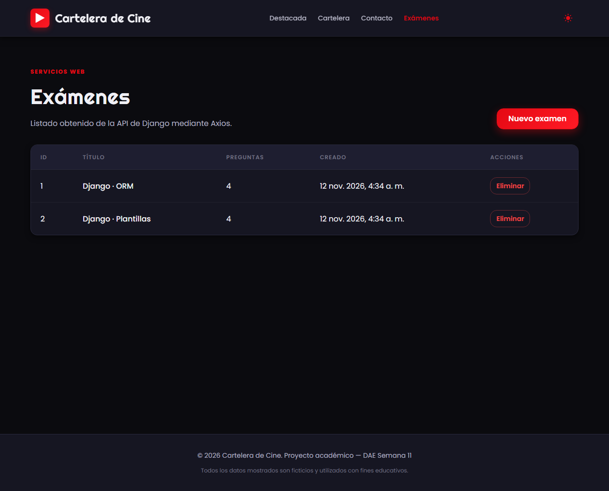
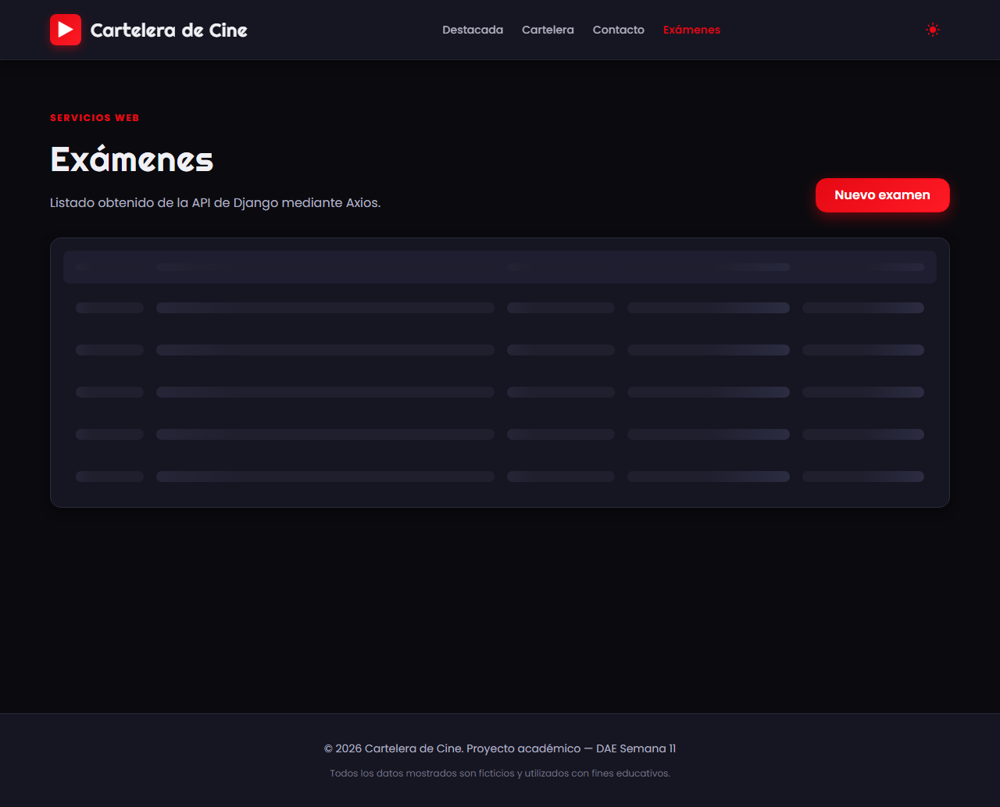
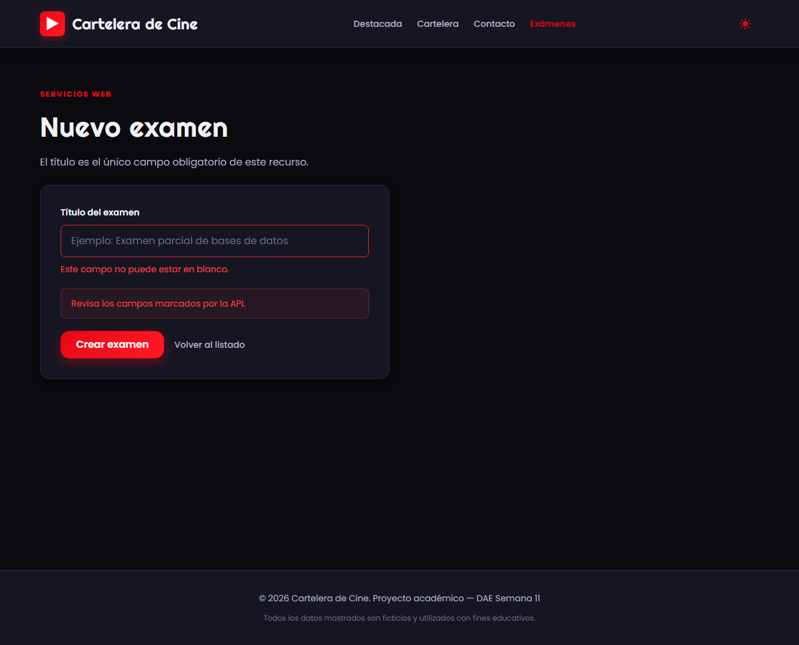
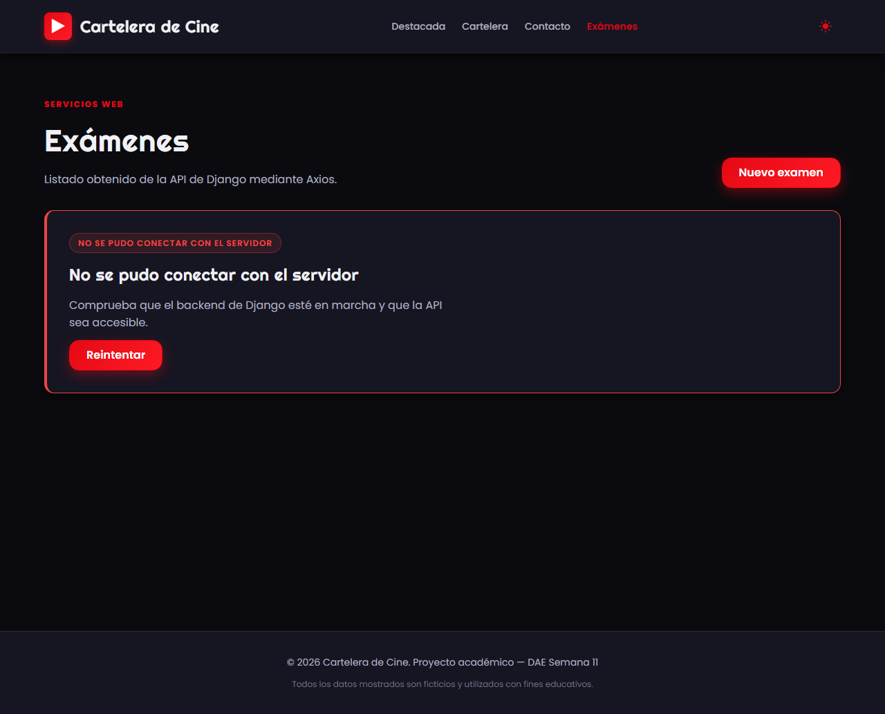
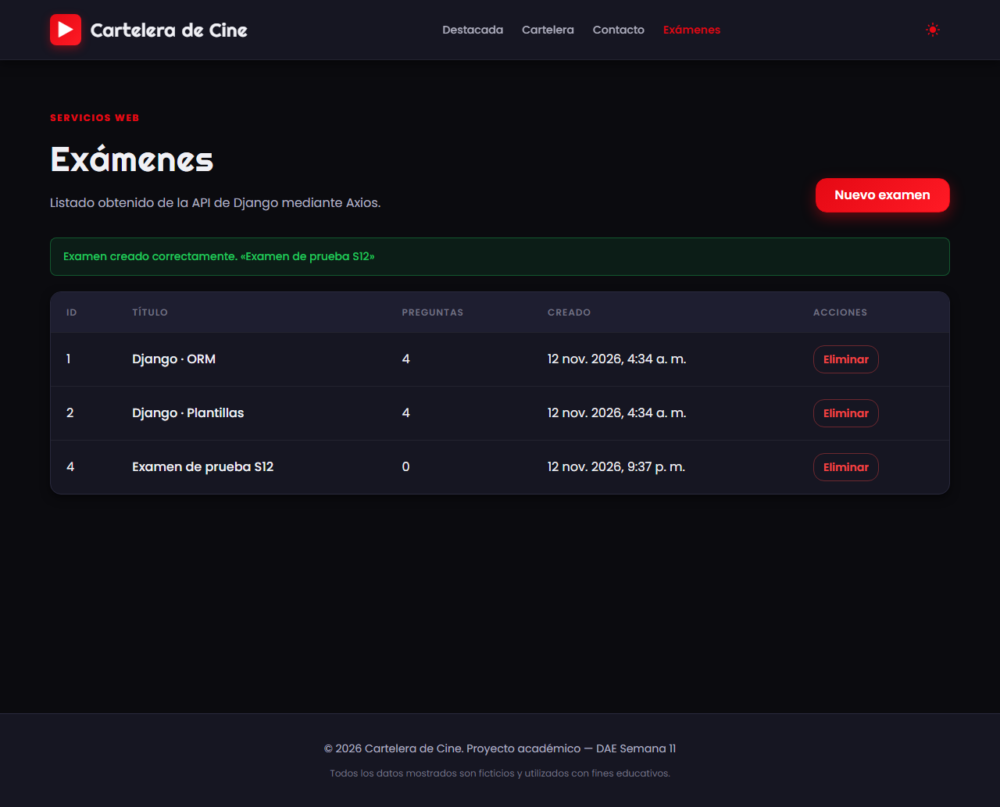
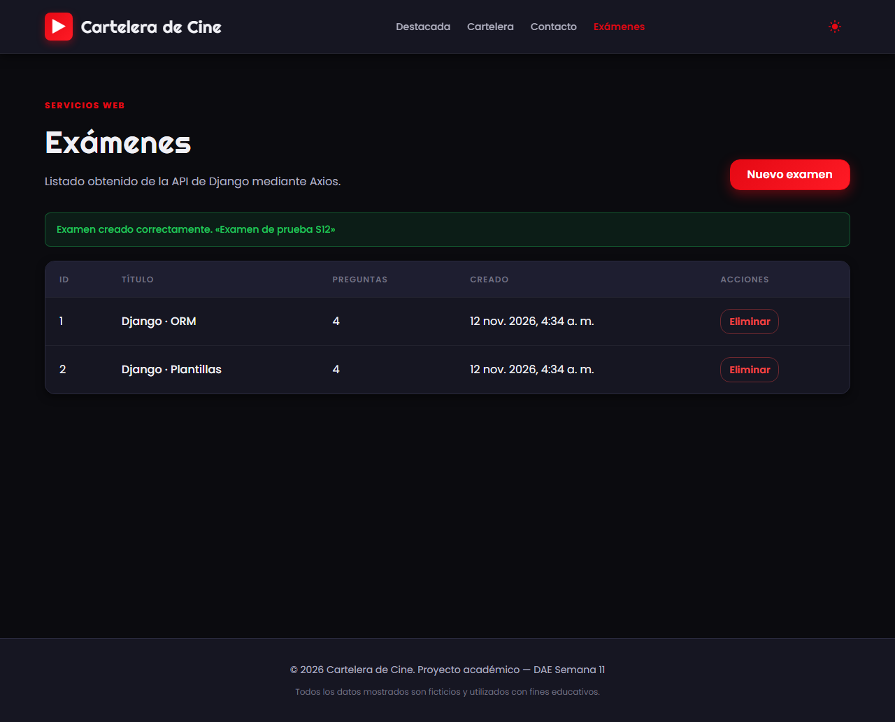
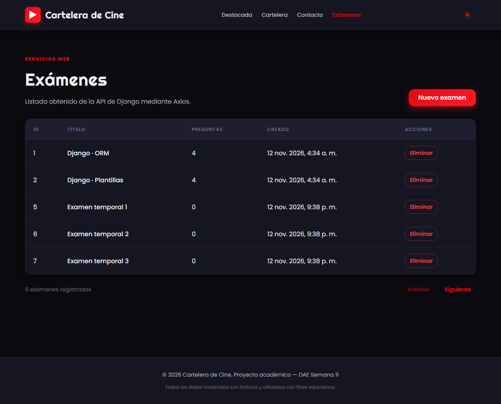

# Servicios Web

**Alumno:** Michael Montgomery Rosell  
**Curso:** Desarrollo de Aplicaciones Empresariales  
**Laboratorio:** GLAB-S12 — Servicios Web  
**Título del desarrollo:** Integración de una API REST de Django con una aplicación React mediante Axios  
**Repositorio:** https://github.com/Fernando-Correa-27/DAE_Semana_12

---

## 1. Objetivo

Integrar la API REST de cuestionarios desarrollada en el laboratorio 8 con la aplicación React de la cartelera de cine del laboratorio 11. La integración debía permitir listar, crear y eliminar exámenes desde la interfaz, respetando la autenticación por token, la paginación de la API y los tres estados de una petición: carga, datos y error. Además, se debía habilitar CORS únicamente para el origen del frontend, sin usar comodines.

## 2. Inspección previa de ambos proyectos

Antes de escribir código se revisaron los dos proyectos y se confirmó lo siguiente:

- **Rutas reales de la API:** `config/urls.py` publica `/api/` y el enrutador de `quiz/urls.py` registra `exams`, `questions` y `options`; por tanto, los recursos son `/api/exams/`, `/api/questions/` y `/api/options/`, además de `/api/schema/` y `/api/docs/`.
- **Campos del recurso examen:** `id`, `title`, `created_at` y `question_count`; solo `title` es obligatorio y editable.
- **Paginación y permisos:** la API usa `PageNumberPagination` con `PAGE_SIZE = 5` y devuelve `{count, next, previous, results}`; todos los recursos exigen autenticación por token en la cabecera `Authorization: Token <token>`.
- **Enrutado de React:** el proyecto del laboratorio 11 no usaba `react-router-dom`; se instaló para añadir `/exams` y `/exams/new` sin alterar la cartelera.

## 3. Estructura de la entrega

```text
dae-s12-servicios-web/
├── backend/     API Django REST del laboratorio 8
├── frontend/    Aplicación React + Vite del laboratorio 11
├── docs/
│   ├── capturas/
│   ├── evidencias.md
│   └── estructura.txt
├── README.md
└── ENTREGABLE.md
```

[CAPTURA PENDIENTE: estructura del proyecto en el editor. Pegar aquí la captura de las carpetas `backend/`, `frontend/` y `docs/`.]

## 4. Código relevante

### 4.1 CORS restringido por variable de entorno (`backend/config/settings.py`)

```python
def _cors_allowed_origins():
    """Exact browser origins allowed to call the API."""
    raw = os.environ.get("CORS_ALLOWED_ORIGINS", "http://localhost:5173")
    origins = [origin.strip() for origin in raw.split(",") if origin.strip()]
    if not origins:
        raise ImproperlyConfigured(
            "CORS_ALLOWED_ORIGINS must list at least one exact origin, comma separated."
        )
    if "*" in origins:
        raise ImproperlyConfigured(
            "CORS_ALLOWED_ORIGINS cannot contain '*': list the exact frontend origins."
        )
    return origins


CORS_ALLOWED_ORIGINS = _cors_allowed_origins()
CORS_ALLOW_CREDENTIALS = False
```

El middleware se colocó justo después del de seguridad:

```python
MIDDLEWARE = [
    "django.middleware.security.SecurityMiddleware",
    "corsheaders.middleware.CorsMiddleware",
    "django.contrib.sessions.middleware.SessionMiddleware",
    # ...
]
```

La aplicación `corsheaders` se añadió a `INSTALLED_APPS` y `django-cors-headers` a `requirements.txt`. No se utilizó `CORS_ALLOW_ALL_ORIGINS` ni el comodín `*`.

### 4.2 Cliente único de Axios (`frontend/src/services/apiClient.js`)

```javascript
const DEFAULT_BASE_URL = 'http://127.0.0.1:8000/api'

const baseURL = (import.meta.env.VITE_API_BASE_URL || DEFAULT_BASE_URL).replace(/\/+$/, '')
const token = (import.meta.env.VITE_API_TOKEN || '').trim()

const apiClient = axios.create({
  baseURL,
  timeout: 10000,
  headers: { Accept: 'application/json' },
})

if (token) {
  apiClient.interceptors.request.use((config) => {
    config.headers.Authorization = `Token ${token}`
    return config
  })
}
```

Ningún componente escribe la dirección de la API: todos usan este módulo.

### 4.3 Funciones de listar, crear y eliminar (`frontend/src/services/examsService.js`)

```javascript
const EXAMS_PATH = '/exams/'

export async function listExams(pageUrl = EXAMS_PATH) {
  const { data } = await apiClient.get(pageUrl)
  return data
}

export async function createExam(payload) {
  const { data } = await apiClient.post(EXAMS_PATH, payload)
  return data
}

export async function deleteExam(examId) {
  await apiClient.delete(`${EXAMS_PATH}${examId}/`)
}
```

### 4.4 Lectura paginada y estados (`frontend/src/hooks/useExams.js`)

```javascript
let data = await listExams(pageUrl)
let loadedUrl = pageUrl

while (focusId && data.next && !data.results.some((exam) => exam.id === focusId)) {
  loadedUrl = data.next
  data = await listExams(loadedUrl)
}

setExams(data.results ?? [])
setPagination({
  count: data.count ?? 0,
  next: data.next ?? null,
  previous: data.previous ?? null,
})
setError(null)
setStatus('success')
```

La petición inicial se ejecuta dentro de `useEffect` al montar la página. Se lee siempre `results`, nunca el arreglo directo, y los botones **Anterior** y **Siguiente** usan `previous` y `next`.

### 4.5 Error específico: red frente a HTTP (`frontend/src/utils/apiError.js`)

```javascript
if (response) {
  const data = response.data
  const fieldErrors = {}
  let detail = ''

  if (data && typeof data === 'object' && !Array.isArray(data)) {
    Object.entries(data).forEach(([field, value]) => {
      if (field === 'detail' || field === 'non_field_errors') {
        detail = toMessage(value)
      } else {
        fieldErrors[field] = toMessage(value)
      }
    })
  }

  return { kind: 'http', status: response.status, detail, fieldErrors }
}

if (error?.request) {
  return { kind: 'network', status: null, detail: '', fieldErrors: {} }
}
```

La interfaz muestra «No se pudo conectar con el servidor» cuando no hubo respuesta y, cuando sí la hubo, el código HTTP y el detalle devuelto por la API.

### 4.6 Alta controlada con validación por campo (`frontend/src/components/ExamForm/ExamForm.jsx`)

```javascript
const handleSubmit = (event) => {
  event.preventDefault()
  onSubmit({ title })
}

const handleChange = (event) => {
  setTitle(event.target.value)
  if (onFieldChange) onFieldChange()
}
```

El formulario no bloquea el envío de un título vacío en el navegador: deja que la API responda `400` y muestra el mensaje por campo que devuelve Django REST Framework.

### 4.7 Rutas de React (`frontend/src/main.jsx`)

```jsx
<BrowserRouter>
  <Routes>
    <Route path="/" element={<App />} />
    <Route path="/exams" element={<ExamsPage />} />
    <Route path="/exams/new" element={<ExamCreatePage />} />
    <Route path="*" element={<Navigate to="/" replace />} />
  </Routes>
</BrowserRouter>
```

La cartelera conserva su funcionamiento. El menú de navegación incorpora el enlace **Exámenes** y el resto de enlaces siguen llevando a las secciones de la cartelera.

## 5. Explicación del resultado

La sección `/exams` consume la API real. Al entrar se ejecuta un `GET` a `/api/exams/` con el token configurado en `VITE_API_TOKEN`. Mientras llega la respuesta se muestra un esqueleto de carga. Si la respuesta es correcta, se muestra una tabla con el identificador, el título, el número de preguntas, la fecha de creación y el botón de borrado. Si hay más de cinco exámenes, aparecen los botones **Anterior** y **Siguiente**.

El botón **Nuevo examen** abre `/exams/new`. El formulario tiene una entrada controlada y envía un `POST` con el cuerpo en JSON. Si la API responde `201`, se navega al listado y el registro recién creado queda visible sin recargar el navegador; si la API responde `400`, el mensaje del campo `title` se muestra debajo del campo. Si el backend está apagado, la pantalla muestra el estado de error con un botón **Reintentar** y no una pantalla en blanco.

El borrado pide confirmación, deshabilita el botón de la fila mientras la petición está en curso y, al terminar, recarga la lista actual sin recargar la página.

## 6. Casos de prueba

| N.º | Caso | Acción | Resultado esperado | Resultado obtenido |
|---|---|---|---|---|
| 1 | CORS con origen autorizado | `curl` con `Origin: http://localhost:5173` | `200` y `Access-Control-Allow-Origin: http://localhost:5173` | Correcto |
| 2 | CORS con origen no autorizado | `curl` con `Origin: http://evil.example` | Sin cabecera `Access-Control-Allow-Origin` | Correcto |
| 3 | Preflight OPTIONS autorizado | `curl -X OPTIONS` con origen y método | `200` con `Access-Control-Allow-Methods` y `Allow-Headers` | Correcto |
| 4 | Preflight desde origen no autorizado | `curl -X OPTIONS` con origen ajeno | Sin cabeceras `Access-Control-*` | Correcto |
| 5 | Listado de exámenes | Abrir `/exams` | Tabla con los exámenes y paginación si aplica | Correcto |
| 5b | Paginación | Crear exámenes hasta superar 5 y abrir `/exams` | 5 filas en la primera página; Siguiente habilitado; 1 fila y Anterior habilitado en la segunda | Correcto |
| 6 | Estado de carga | Abrir `/exams` con respuesta demorada | Esqueleto de tabla visible | Correcto |
| 7 | Error HTTP | Provocar `401` o `400` | Código HTTP y detalle de la API | Correcto |
| 8 | Sin conexión | Apagar Django y recargar `/exams` | Mensaje «No se pudo conectar con el servidor» y botón Reintentar | Correcto |
| 9 | Error de CORS | Reiniciar Django con otro origen y recargar | Estado de error, no pantalla en blanco; error de CORS en consola | Correcto |
| 10 | Alta correcta | Enviar un título válido | `201`, navegación al listado y fila nueva visible sin recargar | Correcto |
| 11 | Validación | Enviar el título vacío | `400` y mensaje «Este campo no puede estar en blanco.» bajo el campo | Correcto |
| 12 | Borrado | Pulsar Eliminar y confirmar | Botón deshabilitado durante la petición; fila eliminada sin recargar | Correcto |
| 13 | Pruebas del backend | `python manage.py test` | Todas en verde | 372 pruebas OK |
| 14 | Pruebas del frontend | `npm test` | Todas en verde | 58 pruebas OK |
| 15 | Compilación | `npm run build` | Compilación correcta | Correcto |
| 16 | Análisis estático | `npm run lint` | Sin errores | Correcto |

## 7. Tabla de la pantalla

| Momento | Petición | Qué se muestra |
|---|---|---|
| Al entrar en `/exams` | `GET http://127.0.0.1:8000/api/exams/` con `Authorization: Token <token>` | Primero el esqueleto de carga; después la tabla o el panel de error. |
| Estado de carga | La petición está en curso | Esqueleto de tabla con filas animadas y el texto accesible «Cargando exámenes…». |
| Estado de datos | La API responde `200` | Tabla con ID, título, preguntas, fecha y acciones. Si hay más páginas, botones Anterior y Siguiente. |
| Estado de error sin respuesta | La petición no obtiene respuesta | «No se pudo conectar con el servidor», explicación y botón Reintentar. |
| Estado de error HTTP | La API responde `4xx` o `5xx` | Código HTTP y detalle devuelto por la API, con botón Reintentar. |
| Alta | `POST http://127.0.0.1:8000/api/exams/` con `{"title": "..."}` | Si es correcta, vuelve al listado con el nuevo registro; si es `400`, muestra el error por campo. |
| Borrado | `DELETE http://127.0.0.1:8000/api/exams/<id>/` | El botón se deshabilita mientras dura la petición y la lista se refresca al terminar. |

## 8. Capturas

### 8.1 Resultado: listado con datos



[CAPTURA: pegar aquí la imagen del listado con los exámenes.]

### 8.2 Resultado: estado de carga



[CAPTURA: pegar aquí la imagen del esqueleto de carga.]

### 8.3 Error provocado: validación con campo obligatorio vacío



[CAPTURA: pegar aquí la imagen del mensaje «Este campo no puede estar en blanco.».]

### 8.4 Error provocado: CORS con un origen no autorizado



[CAPTURA: pegar aquí la imagen del estado de error y, si se desea, el mensaje de la consola del navegador.]

### 8.5 Error provocado: servidor de Django apagado


[CAPTURA: pegar aquí la imagen del estado «No se pudo conectar con el servidor».]

### 8.6 Alta y borrado sin recargar



[CAPTURA: pegar aquí la imagen del listado con el examen recién creado.]



[CAPTURA: pegar aquí la imagen del listado después de eliminar el examen.]

### 8.7 Estructura del proyecto

[CAPTURA PENDIENTE: pegar aquí la captura del explorador de archivos o del editor con `backend/`, `frontend/` y `docs/`.]

### 8.8 Paginación



[CAPTURA: pegar aquí la imagen de la primera página con los botones Anterior y Siguiente.]

## 9. Resultados de las pruebas

- Backend: `python manage.py test` → **372 pruebas OK**, incluidas 7 pruebas de CORS.
- Frontend: `npm test` → **58 pruebas OK** en 11 archivos.
- Compilación: `npm run build` → correcta.
- Lint: `npm run lint` → sin errores ni advertencias.
- CORS con `curl`: origen autorizado con cabecera, origen ajeno sin cabecera y preflight correcto.
- Navegador: se provocaron el error de validación, el error de CORS y el apagado del servidor; en los tres casos la interfaz mostró un estado explícito. También se comprobó la paginación real con 5 elementos en la primera página y 1 en la segunda.

El detalle de comandos y salidas está en `docs/evidencias.md`.

## 10. Conclusiones

La integración cumple el objetivo del laboratorio: React consume la API de Django mediante Axios y ofrece una sección de exámenes completa, separada de la cartelera y sin romper el funcionamiento anterior. La configuración de CORS quedó restringida a orígenes exactos y demostró con peticiones reales que un origen ajeno no recibe permiso, lo que evita el uso inseguro del comodín.

El manejo de estados fue uno de los puntos centrales. La pantalla distingue con claridad la carga, los datos y el error; además, el error no es genérico: diferencia la falta de conexión de una respuesta HTTP y muestra el código y el detalle de la API. Esto facilita el diagnóstico tanto al desarrollador como al usuario.

Las operaciones de listar, crear y eliminar funcionan contra la API real. La lista se actualiza sin recargar el navegador, el formulario respeta las validaciones del servidor y el borrado protege la fila mientras la petición está en curso. Las pruebas automatizadas y las capturas respaldan el resultado.

Como mejora futura, el token de la API no debería exponerse permanentemente en una variable de Vite en un entorno de producción; convendría usar un backend intermedio o tokens de corta duración. Para el alcance local de este laboratorio, la solución es suficiente y deja el camino preparado para ese cambio.

## 11. Decisiones y pendientes

**Decisiones tomadas:**

- Se instaló `react-router-dom` porque el proyecto de React no tenía enrutado.
- Se creó una instancia única de Axios y un módulo de servicio para que ningún componente escriba direcciones de la API.
- Se extrajo el hook `useTheme` para compartir el tema entre la cartelera y las páginas de exámenes sin duplicar lógica.
- La cabecera oculta el contador de favoritos fuera de la cartelera para no mostrar un dato que no corresponde a esa pantalla.
- El token se entrega mediante `VITE_API_TOKEN` y solo se versiona `.env.example`.
- Se añadieron pruebas de CORS en el backend y pruebas unitarias del formulario y del normalizador de errores en el frontend.

**Pendiente manual:**

- Captura de la estructura del proyecto en el editor, indicada en el apartado 8.7.
