# Entregable — Laboratorio 13

**Alumno:** [NOMBRE DEL ALUMNO]  
**Curso:** Desarrollo de Aplicaciones Empresariales  
**Laboratorio:** GLAB-S13 — Estructura de una aplicación de comercio electrónico  
**Título del desarrollo:** Catálogo de productos con Django REST Framework y React  
**Repositorio:** `DAE_Semana_13` (privado)

---

## 1. Resumen

Se amplió el proyecto de la semana 12 con un catálogo de comercio electrónico. El servidor Django incorpora la app `catalog`, con los modelos `Category` y `Product`, imágenes gestionadas con Pillow, admin, datos semilla reproducibles y una API REST paginada. El cliente React consume esa API mediante una capa de servicios con Axios y ofrece listado, filtro por categoría, alta, edición y borrado sin recargar la página.

La API de cuestionarios de la semana 12 se conserva con su autenticación por token. El catálogo es público (`AllowAny`) para que la pantalla funcione sin credenciales y para no mezclar la sesión del catálogo con el token de los exámenes.

## 2. Arquitectura y reparto de responsabilidades

| Lado | Tecnología | Responsabilidad | Puerto |
|---|---|---|---|
| Servidor | Django 6.1 + DRF + Pillow | Modelos, migraciones, admin, serializadores, vistas, filtro, imágenes y semilla | `8000` |
| Cliente | React 19 + Vite 8 + Axios | Rutas, componentes, estados, formularios y llamadas HTTP | `5173` |

Flujo de una pantalla de catálogo:

```text
React (localhost:5173)
  └── CatalogPage
        ├── useCategories() ──> categoryService.list() ──> GET /api/categories/
        └── useProducts()   ──> productService.list()  ──> GET /api/products/?page=1&category=2
                                                                  │
                                                                  ▼
                                                        ProductViewSet
                                                        select_related("category")
                                                                  │
                                                                  ▼
                                                        JSON con categoría anidada
```

El servidor solo acepta el origen exacto `http://localhost:5173`, configurado en `CORS_ALLOWED_ORIGINS`. No se usa el comodín `*`.

## 3. Modelo de datos

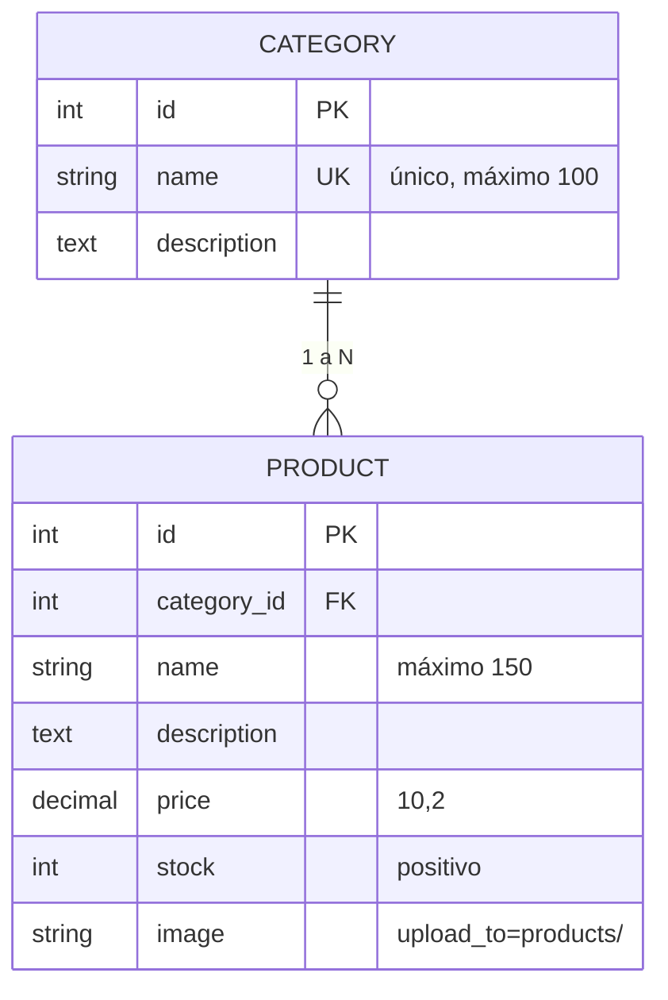

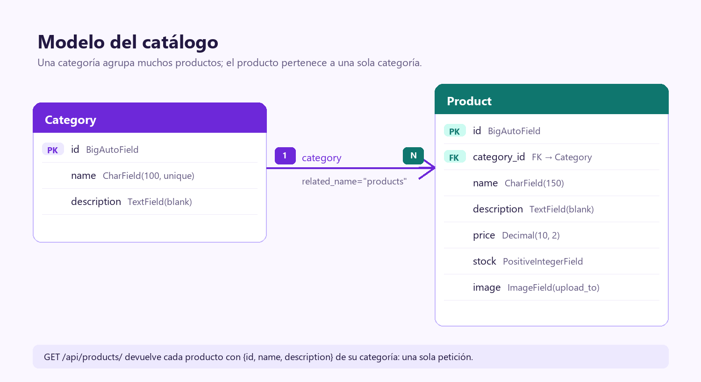

Decisiones del modelo:

- `Category.name` es único para que el desplegable no repita opciones.
- `Product.category` usa `related_name="products"`; así una categoría conoce sus productos y el admin puede contar cuántos tiene.
- `price` es `DecimalField(max_digits=10, decimal_places=2)` para no arrastrar errores de coma flotante.
- `stock` es `PositiveIntegerField`; el serializer además rechaza precios negativos.
- `image` es `ImageField(upload_to="products/")`; Pillow es obligatorio para validar la imagen.
- `Product.Meta.ordering = ["name"]` mantiene un orden estable entre peticiones y páginas.

## 4. API del catálogo

| Método | Ruta | Descripción | Respuesta esperada |
|---|---|---|---|
| `GET` | `/api/categories/` | Lista completa, sin paginar | `200` con un arreglo de categorías |
| `POST` | `/api/categories/` | Crea una categoría | `201` con la categoría creada |
| `GET` | `/api/categories/{id}/` | Detalle de una categoría | `200` con la categoría |
| `PUT/PATCH` | `/api/categories/{id}/` | Actualiza una categoría | `200` con la categoría actualizada |
| `DELETE` | `/api/categories/{id}/` | Elimina una categoría | `204` sin cuerpo |
| `GET` | `/api/products/` | Lista paginada con categoría anidada | `200` con `{count, next, previous, results}` |
| `GET` | `/api/products/?category={id}` | Filtra por categoría | `200` con la misma estructura paginada |
| `POST` | `/api/products/` | Crea un producto; acepta `multipart/form-data` | `201` con el producto y su categoría |
| `GET` | `/api/products/{id}/` | Detalle de un producto | `200` con el producto |
| `PUT/PATCH` | `/api/products/{id}/` | Actualiza un producto | `200` con el producto actualizado |
| `DELETE` | `/api/products/{id}/` | Elimina un producto | `204` sin cuerpo |

### 4.1. Categorías

`GET /api/categories/` responde sin paginación, porque el desplegable necesita la lista completa:

```json
[
  {
    "id": 1,
    "name": "Tecnología",
    "description": "Dispositivos y accesorios para el trabajo y el tiempo libre."
  },
  {
    "id": 2,
    "name": "Hogar",
    "description": "Objetos cotidianos con un diseño cálido y funcional."
  },
  {
    "id": 3,
    "name": "Accesorios",
    "description": "Complementos para acompañar el día a día."
  }
]
```

### 4.2. Productos con la categoría anidada

`GET /api/products/` devuelve la categoría completa dentro de cada producto, en **una sola petición**:

```json
{
  "count": 9,
  "next": "http://127.0.0.1:8000/api/products/?page=2",
  "previous": null,
  "results": [
    {
      "id": 1,
      "name": "Auriculares Nova",
      "description": "Auriculares inalámbricos con cancelación activa de ruido y 30 horas de batería.",
      "price": "249.90",
      "stock": 18,
      "image": "http://127.0.0.1:8000/media/products/auriculares-nova.jpg",
      "category": {
        "id": 1,
        "name": "Tecnología",
        "description": "Dispositivos y accesorios para el trabajo y el tiempo libre."
      }
    }
  ]
}
```

El serializer separa lectura y escritura: `category` es de solo lectura y `category_id` es de solo escritura.

```python
class ProductSerializer(serializers.ModelSerializer):
    category = CategorySerializer(read_only=True)
    category_id = serializers.PrimaryKeyRelatedField(
        queryset=Category.objects.all(),
        source="category",
        write_only=True,
    )
```

### 4.3. Filtro por categoría

`GET /api/products/?category=2` devuelve únicamente los productos de esa categoría, conservando la paginación. Un valor no numérico responde `400` con un mensaje claro.

### 4.4. Alta con imagen

La creación usa `multipart/form-data` porque puede incluir un archivo:

```text
POST /api/products/
Content-Type: multipart/form-data

name=Auriculares Nova
description=Auriculares inalámbricos...
category_id=1
price=249.90
stock=18
image=<archivo.jpg>
```

### 4.5. Error de validación

Si falta un campo obligatorio, DRF responde `400` y el cliente muestra el mensaje junto al campo:

```json
{
  "name": ["This field is required."],
  "category_id": ["This field is required."],
  "price": ["A valid number is required."],
  "stock": ["A valid integer is required."]
}
```

## 5. Capturas de pantalla

Todas las imágenes están en `entregable/capturas/`. Fueron capturadas con Playwright sobre la aplicación real, revisadas visualmente y corregidas antes de commitearlas.

### Captura 01 — Listado de categorías en el admin

**Título del desarrollo:** Registro de `Category` en el admin de Django.

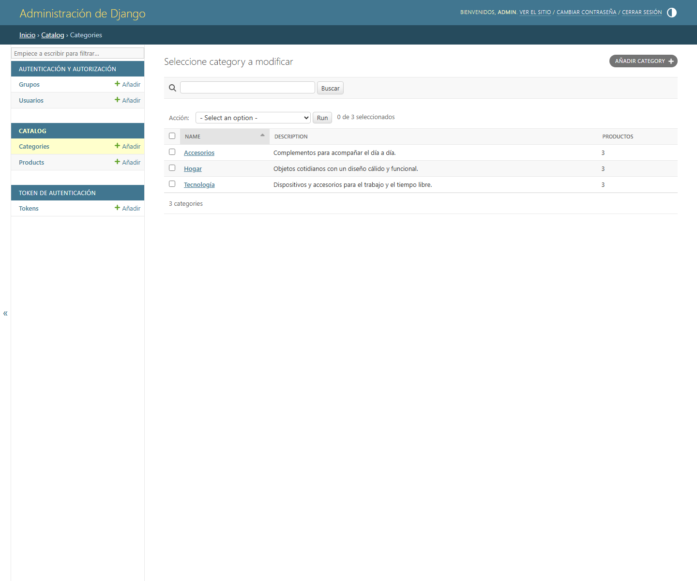

**Código relevante** (`backend/catalog/admin.py`):

```python
@admin.register(Category)
class CategoryAdmin(admin.ModelAdmin):
    list_display = ("name", "description", "products_total")
    search_fields = ("name", "description")

    def get_queryset(self, request):
        queryset = super().get_queryset(request)
        return queryset.annotate(products_total=Count("products"))

    @admin.display(description="Productos", ordering="products_total")
    def products_total(self, obj):
        return obj.products_total
```

**Explicación del resultado:** el admin muestra las tres categorías semilla, su descripción y cuántos productos tiene cada una. La columna `Productos` se calcula con `annotate(Count("products"))`, así que no se ejecuta una consulta por fila. La barra lateral confirma que el admin está habilitado y que el catálogo convive con la app `quiz`.

**Casos de prueba:**

- Abrir `/admin/catalog/category/` con un superusuario: se ven exactamente 3 filas.
- Buscar `Hogar`: la tabla queda filtrada a una fila.
- Ordenar por la columna `Productos`: las categorías quedan ordenadas por cantidad.
- Crear una categoría con un nombre repetido: el admin rechaza el duplicado por la restricción `unique`.

### Captura 02 — Listado de productos con filtro por categoría

**Título del desarrollo:** Registro de `Product`, filtro por categoría y miniatura de la imagen.

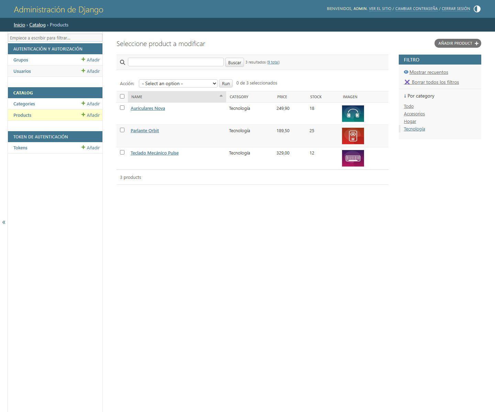

**Código relevante** (`backend/catalog/admin.py`):

```python
@admin.register(Product)
class ProductAdmin(admin.ModelAdmin):
    list_display = ("name", "category", "price", "stock", "image_preview")
    list_filter = ("category",)
    search_fields = ("name", "description", "category__name")
    list_select_related = ("category",)
    readonly_fields = ("image_preview",)

    @admin.display(description="Imagen")
    def image_preview(self, obj):
        if not obj.image:
            return "Sin imagen"
        # La CSP del proyecto bloquea estilos en línea: el tamaño va en atributos.
        return format_html(
            '',
            obj.image.url,
            obj.name,
        )
```

**Explicación del resultado:** el listado está filtrado por la categoría `Tecnología` (3 de 9 productos) y muestra nombre, categoría, precio, existencias y una miniatura. El filtro lateral permite cambiar de categoría; la búsqueda cubre también el nombre de la categoría. La miniatura usa atributos HTML porque la política CSP del proyecto (`default-src 'self'`) bloquea los estilos en línea; fue un defecto detectado en la primera captura y corregido.

**Casos de prueba:**

- Entrar a `/admin/catalog/product/?category__id__exact=1`: aparecen solo los 3 productos de Tecnología.
- Quitar el filtro: aparecen los 9 productos.
- Buscar `mochila`: aparece `Mochila Urbana Trek`.
- Abrir un producto sin imagen: la columna muestra `Sin imagen` sin romper la tabla.

### Captura 03 — `/api/products/` con la categoría anidada

**Título del desarrollo:** Serializer de producto con categoría anidada y `select_related`.

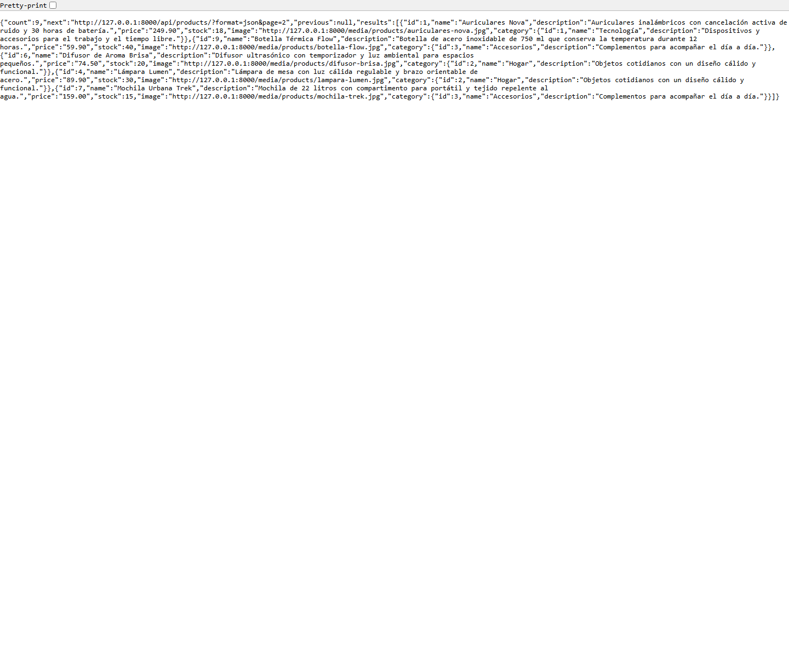

**Código relevante** (`backend/catalog/serializers.py` y `views.py`):

```python
class ProductSerializer(serializers.ModelSerializer):
    category = CategorySerializer(read_only=True)
    category_id = serializers.PrimaryKeyRelatedField(
        queryset=Category.objects.all(),
        source="category",
        write_only=True,
    )

    class Meta:
        model = Product
        fields = [
            "id", "name", "description", "price", "stock",
            "image", "category", "category_id",
        ]
```

```python
def get_queryset(self):
    queryset = Product.objects.select_related("category")
    raw_category = self.request.query_params.get("category")
    if raw_category is not None:
        value = raw_category.strip()
        if not value.isascii() or not value.isdecimal():
            raise ValidationError(
                {"category": "Expected the id of a category, for example ?category=1."}
            )
        queryset = queryset.filter(category_id=int(value))
    return queryset
```

**Explicación del resultado:** una sola petición devuelve cada producto con `category: {id, name, description}`. El cliente no necesita pedir las categorías por separado para pintar cada tarjeta. `select_related("category")` evita el problema N+1: la categoría viaja en la misma consulta SQL. La respuesta está paginada (`count`, `next`, `previous`, `results`).

**Casos de prueba:**

- `GET /api/products/`: `200` y `count = 9`.
- Comprobar que cada elemento de `results` tiene un objeto `category` con `id`, `name` y `description`.
- `GET /api/products/?category=2`: solo productos de Hogar y `count = 3`.
- `GET /api/products/?category=abc`: `400` con el mensaje del filtro.
- `GET /api/products/?page=2`: segunda página con los 4 productos restantes.

### Captura 04 — `/api/categories/`

**Título del desarrollo:** Listado de categorías sin paginación para el desplegable.

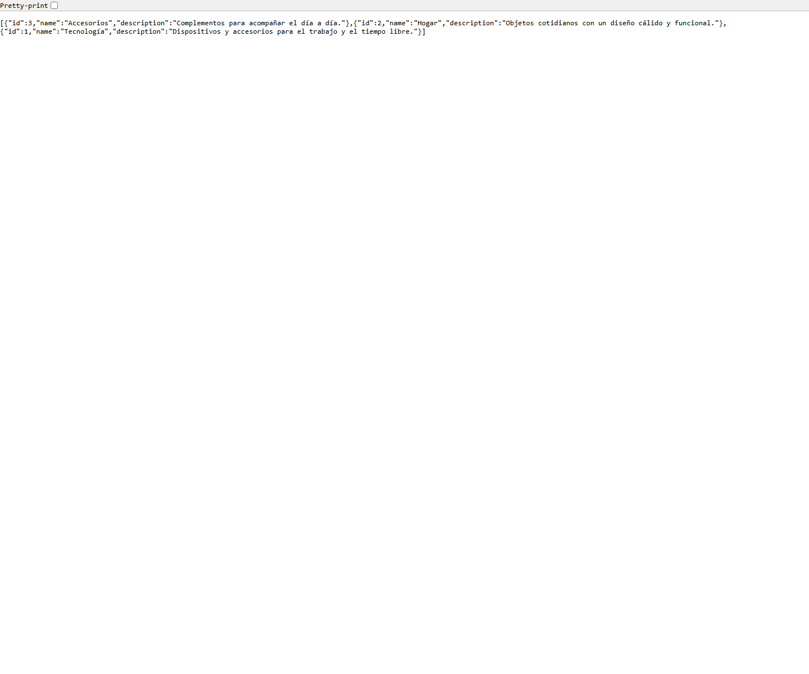

**Código relevante** (`backend/catalog/views.py`):

```python
class CategoryViewSet(viewsets.ModelViewSet):
    """Categories are public and intentionally unpaginated."""

    queryset = Category.objects.all()
    serializer_class = CategorySerializer
    permission_classes = [AllowAny]
    pagination_class = None
```

**Explicación del resultado:** la respuesta es un arreglo plano con las 3 categorías. Si se mantuviera la paginación global (`PAGE_SIZE = 5`), el desplegable solo vería la primera página y el filtro quedaría incompleto cuando el catálogo crezca. Desactivar la paginación en este viewset es una decisión local: los productos siguen paginados.

**Casos de prueba:**

- `GET /api/categories/`: `200` y un arreglo de 3 elementos.
- Crear una categoría con `POST`: `201` y aparece en la siguiente consulta.
- Intentar crear una categoría con nombre repetido: `400`.
- Comprobar que la respuesta **no** tiene `count` ni `results` (no está paginada).

### Captura 05 — Catálogo completo

**Título del desarrollo:** Listado de productos con tarjetas, precios, existencias y categoría.

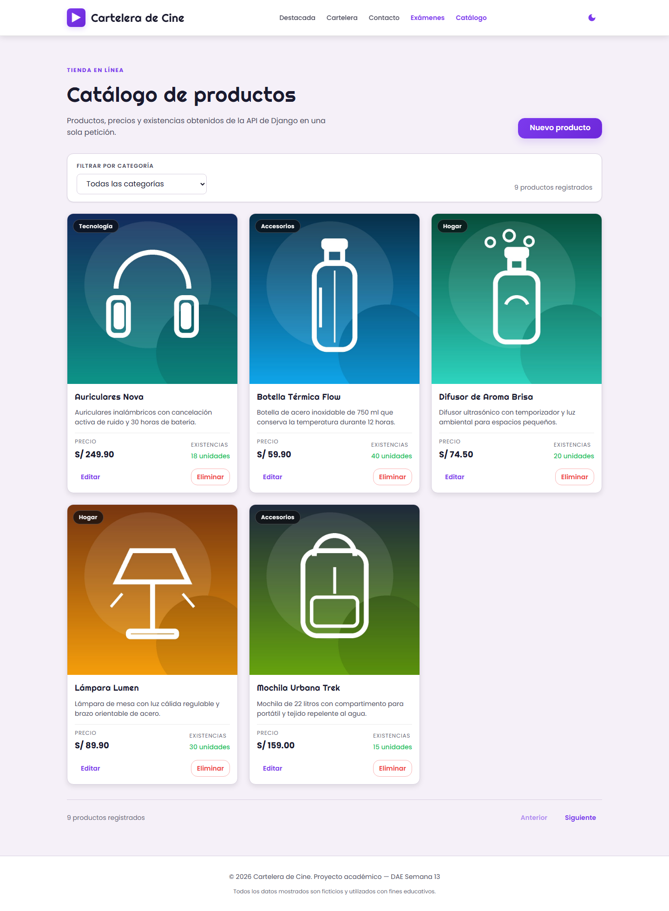

**Código relevante** (`frontend/src/pages/CatalogPage/CatalogPage.jsx`):

```jsx
{status === 'loading' && <CatalogSkeleton />}

{status === 'error' && <CatalogError error={error} onRetry={reload} />}

{status === 'success' && products.length === 0 && (
  <div className="catalog-page__empty">
    <h3>{UI_TEXT.CATALOG_EMPTY_TITLE}</h3>
    <p>{UI_TEXT.CATALOG_EMPTY_MESSAGE}</p>
  </div>
)}

{hasProducts && (
  <div className="catalog-grid">
    {products.map((product) => (
      <ProductCard
        key={product.id}
        product={product}
        onDelete={handleDelete}
        isDeleting={deletingId === product.id}
      />
    ))}
  </div>
)}
```

**Explicación del resultado:** se ven 5 productos en la primera página (el resto está en la página 2) con imagen, nombre, descripción, precio en soles, existencias y la etiqueta de categoría. El contador superior y el pie muestran el total real (`9 productos registrados`), no solo los visibles. Los botones `Anterior` y `Siguiente` siguen los enlaces que entrega la API.

**Casos de prueba:**

- Abrir `/catalog`: se muestran 5 tarjetas y el total 9.
- Pulsar `Siguiente`: se ven los 4 productos restantes y `Anterior` se habilita.
- Comprobar que cada tarjeta tiene imagen, nombre, precio, stock y categoría.
- Reducir el ancho de la ventana: la cuadrícula pasa a menos columnas sin romper las tarjetas.

### Captura 06 — Catálogo filtrado por categoría

**Título del desarrollo:** Filtro por categoría alimentado por la API.

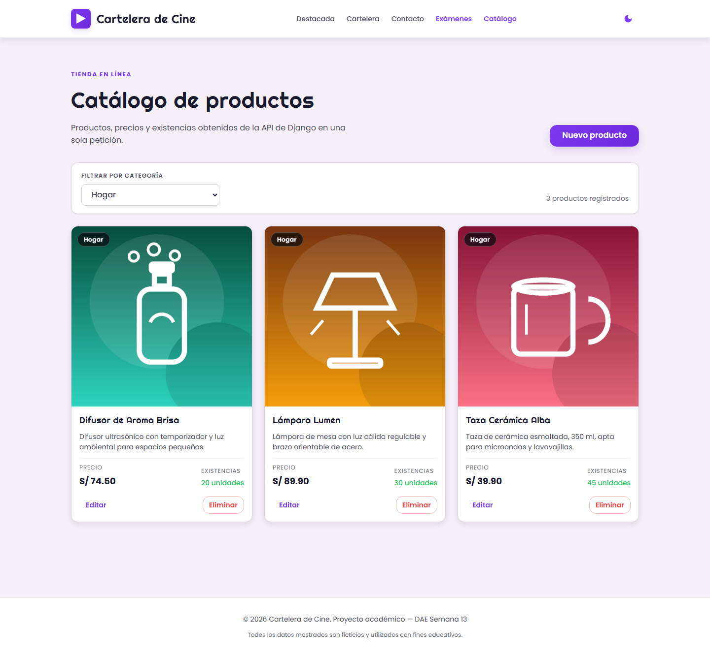

**Código relevante** (`frontend/src/services/productService.js` y `hooks/useProducts.js`):

```js
export async function list({ categoryId = '', page = 1, pageUrl = '' } = {}) {
  if (pageUrl) {
    const { data } = await apiClient.get(pageUrl)
    return data
  }

  const params = { page }
  if (categoryId) params.category = categoryId

  const { data } = await apiClient.get(PRODUCTS_PATH, { params })
  return data
}
```

```jsx
const handleCategoryChange = (value) => {
  setFocusProductId(null)
  setCategoryId(value)
}
```

**Explicación del resultado:** el desplegable incluye la opción `Todas las categorías` y las categorías reales de la API. Al elegir `Hogar`, se solicita `/api/products/?page=1&category=2` y la cuadrícula queda con 3 productos. El contador baja a `3 productos registrados` y la paginación desaparece porque todo cabe en una página.

**Casos de prueba:**

- Seleccionar `Hogar`: solo aparecen Difusor, Lámpara y Taza.
- Volver a `Todas las categorías`: reaparecen los 9 productos y la paginación.
- Filtrar una categoría sin productos (si se crea una): se muestra el estado vacío con la acción para limpiar el filtro.
- Recargar la página: el filtro vuelve a `Todas` (no se guarda en la URL), comportamiento esperado.

### Captura 07 — Estado de carga

**Título del desarrollo:** Esqueleto de carga mientras llega la respuesta.

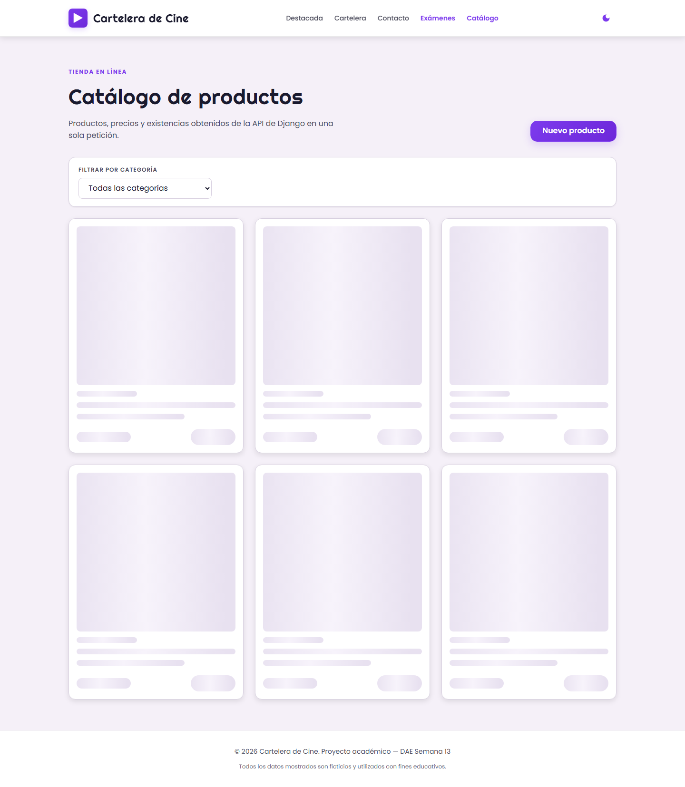

**Código relevante** (`frontend/src/components/CatalogSkeleton/CatalogSkeleton.jsx`):

```jsx
const SKELETON_CARDS = 6

function CatalogSkeleton() {
  return (
    <div className="catalog-skeleton" role="status" aria-live="polite" aria-busy="true">
      <span className="sr-only">{UI_TEXT.CATALOG_LOADING}</span>
      {Array.from({ length: SKELETON_CARDS }, (_, index) => (
        <div className="catalog-skeleton__card" key={index} aria-hidden="true">
          <span className="catalog-skeleton__image" />
          <span className="catalog-skeleton__line catalog-skeleton__line--short" />
          <span className="catalog-skeleton__line" />
          <span className="catalog-skeleton__line catalog-skeleton__line--medium" />
          <div className="catalog-skeleton__footer">
            <span className="catalog-skeleton__price" />
            <span className="catalog-skeleton__button" />
          </div>
        </div>
      ))}
    </div>
  )
}
```

**Explicación del resultado:** mientras `useProducts` está en estado `loading`, se pinta un esqueleto con la misma forma que las tarjetas, sin saltos bruscos de layout. La captura se tomó retrasando las peticiones 2,5 segundos desde el script de Playwright; **la aplicación no incluye ningún retraso artificial**. El esqueleto es decorativo (`aria-hidden`), así que un lector de pantalla no anuncia contenido falso.

**Casos de prueba:**

- Abrir `/catalog` con la red lenta: se ve el esqueleto y luego las tarjetas.
- Cambiar de categoría: el esqueleto reaparece mientras llega la nueva página.
- Comprobar que el esqueleto no muestra textos de productos reales.
- Verificar que el layout no se desplaza cuando llegan los datos.

### Captura 08 — Estado de error con reintento

**Título del desarrollo:** Error de conexión con Django apagado y botón de reintento.

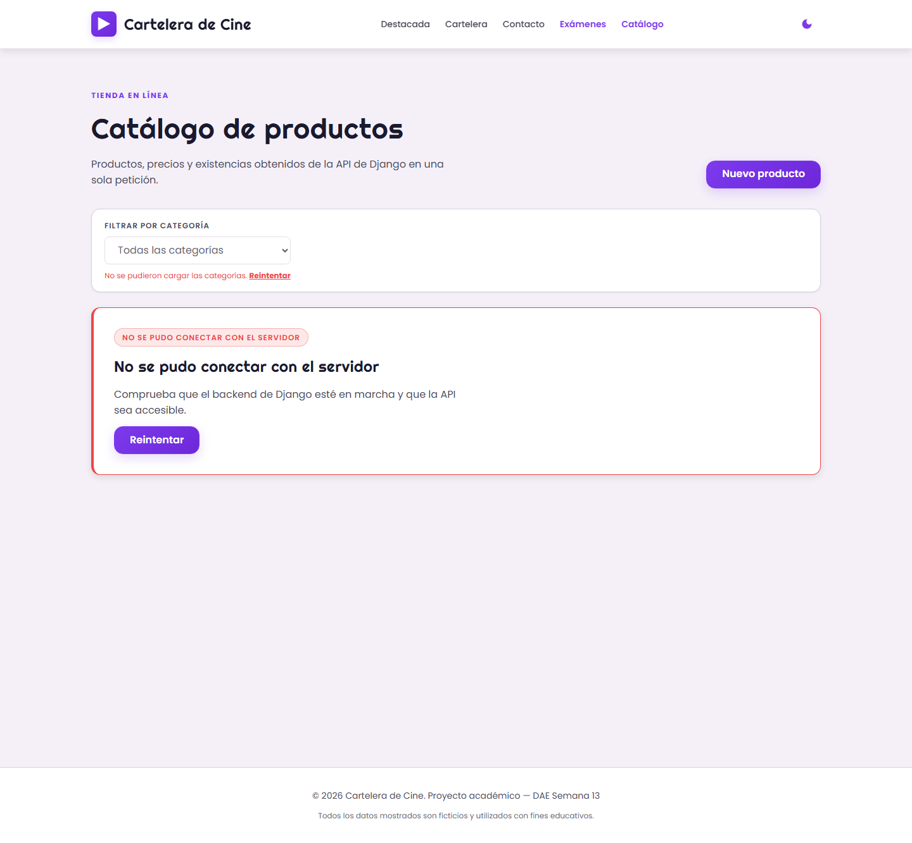

**Código relevante** (`frontend/src/components/CatalogError/CatalogError.jsx` y `CatalogPage.jsx`):

```jsx
{status === 'error' && <CatalogError error={error} onRetry={reload} />}
```

```jsx
function CatalogError({ error, onRetry }) {
  const isNetwork = error?.kind === 'network'
  const isHttp = error?.kind === 'http'

  const title = isNetwork
    ? UI_TEXT.CATALOG_ERROR_CONNECTION_TITLE
    : isHttp
      ? UI_TEXT.CATALOG_ERROR_HTTP_TITLE
      : UI_TEXT.CATALOG_ERROR_UNKNOWN_TITLE

  const message = isNetwork
    ? UI_TEXT.CATALOG_ERROR_CONNECTION_MESSAGE
    : isHttp
      ? UI_TEXT.CATALOG_ERROR_HTTP_MESSAGE
      : UI_TEXT.CATALOG_ERROR_UNKNOWN_MESSAGE

  return (
    <div className="catalog-error" role="alert">
      <span className={`catalog-error__badge${isHttp ? ' catalog-error__badge--http' : ''}`}>
        {isHttp ? `HTTP ${error.status}` : UI_TEXT.CATALOG_ERROR_CONNECTION_TITLE}
      </span>
      <h3 className="catalog-error__title">{title}</h3>
      <p className="catalog-error__message">{message}</p>
      {error?.detail && <p className="catalog-error__detail">{error.detail}</p>}
      <Button onClick={onRetry}>{UI_TEXT.CATALOG_RETRY}</Button>
    </div>
  )
}
```

**Explicación del resultado:** la captura se tomó con el servidor Django detenido. El cliente distingue un fallo de red (sin respuesta) de un error HTTP y muestra un mensaje comprensible, además del botón `Reintentar`. El filtro también informa que no pudo cargar las categorías y ofrece su propio reintento. Al volver a levantar Django, `Reintentar` recupera el catálogo sin recargar la página.

**Casos de prueba:**

- Detener Django y abrir `/catalog`: aparece el error de conexión, no una pantalla en blanco.
- Pulsar `Reintentar` con Django apagado: el error se mantiene.
- Levantar Django y pulsar `Reintentar`: se cargan los productos.
- Provocar un `500` (si se fuerza): se muestra el mensaje HTTP y el mismo botón.

### Captura 09 — Formulario de alta con errores de validación

**Título del desarrollo:** Validación de la API visible en el formulario de alta.

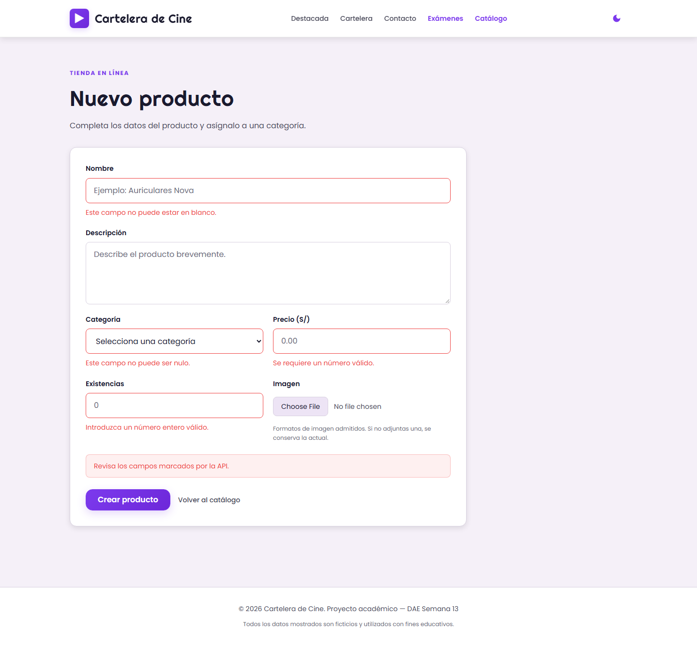

**Código relevante** (`frontend/src/pages/ProductCreatePage/ProductCreatePage.jsx`):

```jsx
try {
  const product = await create(buildProductFormData(values))
  navigate('/catalog', {
    state: {
      createdProductId: product.id,
      createdProductName: product.name,
    },
  })
} catch (requestError) {
  setApiError(normalizeApiError(requestError))
}

const fieldErrors = apiError?.kind === 'http' ? apiError.fieldErrors : {}
const formError = apiError
  ? apiError.kind === 'network'
    ? UI_TEXT.CATALOG_ERROR_CONNECTION_MESSAGE
    : apiError.detail ||
      (Object.keys(fieldErrors).length > 0 ? UI_TEXT.PRODUCT_FORM_FIELD_ERROR : '')
  : ''
```

**Explicación del resultado:** el formulario se envía vacío y el `400` de DRF se reparte por campo: `name`, `category_id`, `price` y `stock` quedan marcados con su mensaje en español y `aria-invalid`. No se valida en el cliente para no duplicar reglas: la API es la fuente de verdad. El formulario se envía con `noValidate`, de modo que el navegador no bloquea el POST antes de llegar al servidor.

**Casos de prueba:**

- Enviar el formulario vacío: aparecen cuatro errores junto a los campos.
- Corregir un campo: su error desaparece al escribir.
- Enviar un precio negativo: la API responde `400` y se muestra el error.
- Detener Django y enviar: se muestra el error de conexión, no un fallo silencioso.

### Captura 10 — Producto nuevo en el catálogo

**Título del desarrollo:** Alta correcta y regreso al catálogo sin recargar.


**Código relevante** (`frontend/src/utils/productPayload.js` y `hooks/useProducts.js`):

```js
export function buildProductFormData(values) {
  const formData = new FormData()
  formData.append('name', values.name)
  formData.append('description', values.description)
  formData.append('category_id', values.categoryId)
  formData.append('price', values.price)
  formData.append('stock', values.stock)

  if (values.image instanceof File) {
    formData.append('image', values.image)
  }

  return formData
}
```

```js
// Si el producto recién creado no está en la primera página, se siguen
// los enlaces `next` hasta encontrarlo.
while (
  focusTarget &&
  data.next &&
  !data.results?.some((item) => item.id === focusTarget)
) {
  const nextUrl = data.next
  data = await list({ pageUrl: nextUrl })
  loadedPage = getPageNumber(nextUrl)
}
```

**Explicación del resultado:** tras el `POST`, la aplicación navega a `/catalog` con el id y el nombre del producto en el estado de React. El catálogo muestra el aviso `Producto creado correctamente` y el producto aparece en la lista (ordenado por nombre, antes de `Auriculares Nova`). El contador sube a 10. No hubo recarga completa: la navegación es del cliente y los datos se vuelven a pedir por la API.

**Casos de prueba:**

- Crear un producto con imagen: `201`, aviso verde y tarjeta visible.
- Crear sin imagen: se guarda con el campo vacío y la tarjeta usa el marcador de posición.
- Crear un producto que cae en la página 2: el hook sigue `next` hasta mostrarlo.
- Comprobar que el formulario queda limpio si se vuelve a abrir.

### Captura 11 — Formulario de edición reutilizado

**Título del desarrollo:** Edición con el mismo formulario controlado del alta.

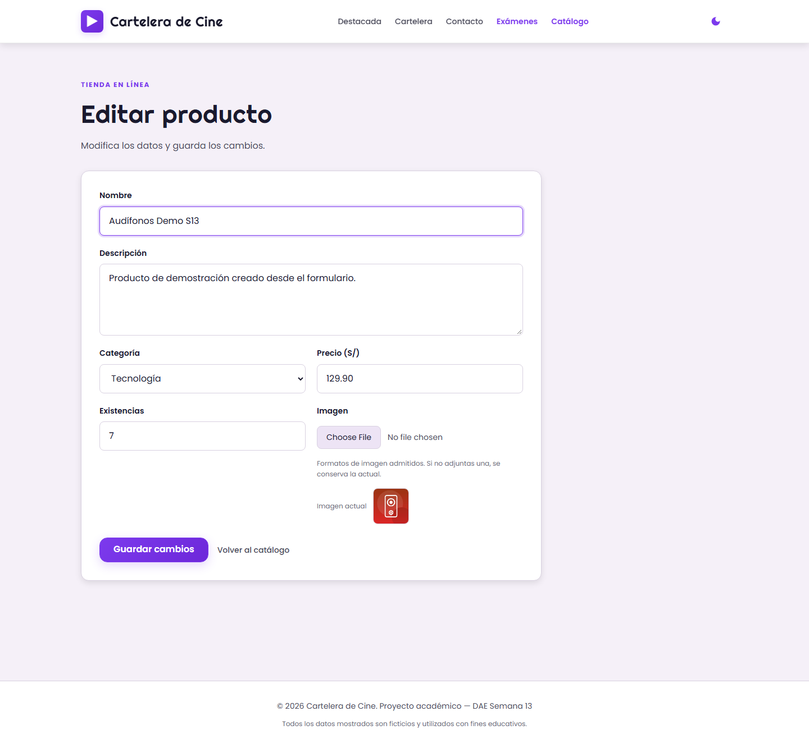

**Código relevante** (`frontend/src/pages/ProductEditPage/ProductEditPage.jsx`):

```jsx
const handleSubmit = async (values) => {
  setIsSubmitting(true)
  setApiError(null)

  try {
    const product = await update(productId, buildProductFormData(values))
    navigate('/catalog', {
      state: {
        updatedProductId: product.id,
        updatedProductName: product.name,
      },
    })
  } catch (requestError) {
    setApiError(normalizeApiError(requestError))
  } finally {
    setIsSubmitting(false)
  }
}

<ProductForm
  mode="edit"
  initialValues={initialValues}
  currentImageUrl={product?.image}
  categories={categoriesState.categories}
  ...
/>
```

**Explicación del resultado:** el formulario llega precargado con los valores del producto y muestra la imagen actual. El componente `ProductForm` es el mismo del alta; solo cambian el título, el método (`PATCH`) y el destino. Se usa `PATCH` para no exigir todos los campos si en el futuro se edita solo una parte.

**Casos de prueba:**

- Abrir `Editar` en una tarjeta: los campos coinciden con la API.
- Cambiar solo el precio y guardar: el resto se conserva.
- Enviar un precio inválido: el error se muestra sin perder lo escrito.
- Adjuntar una imagen nueva: reemplaza la anterior y se ve en el catálogo.

### Captura 12 — Catálogo tras la edición

**Título del desarrollo:** Cambio reflejado en el catálogo sin recargar.

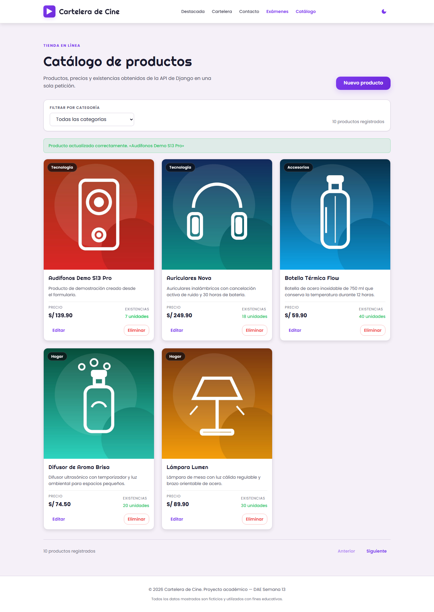

**Código relevante** (`frontend/src/pages/CatalogPage/CatalogPage.jsx`):

```jsx
const [flash, setFlash] = useState(() => {
  if (location.state?.createdProductName) {
    return `${UI_TEXT.CATALOG_CREATED} «${location.state.createdProductName}»`
  }
  if (location.state?.updatedProductName) {
    return `${UI_TEXT.CATALOG_UPDATED} «${location.state.updatedProductName}»`
  }
  return ''
})
```

**Explicación del resultado:** el nombre cambió a `Audífonos Demo S13 Pro` y el precio a `S/ 139.90`. El aviso `Producto actualizado correctamente` confirma la operación. La lista se vuelve a cargar desde la API, así que la tarjeta refleja el dato real y no una copia optimista. La navegación y el refresco ocurren dentro del SPA.

**Casos de prueba:**

- Editar nombre y precio: ambos cambian en la tarjeta.
- Comprobar que el contador no cambia (sigue siendo 10).
- Recargar el navegador: el cambio persiste porque está en la base de datos.
- Editar y volver atrás: el estado de la flash no se repite.

### Captura 13 — Catálogo tras eliminar

**Título del desarrollo:** Borrado con confirmación y actualización local.

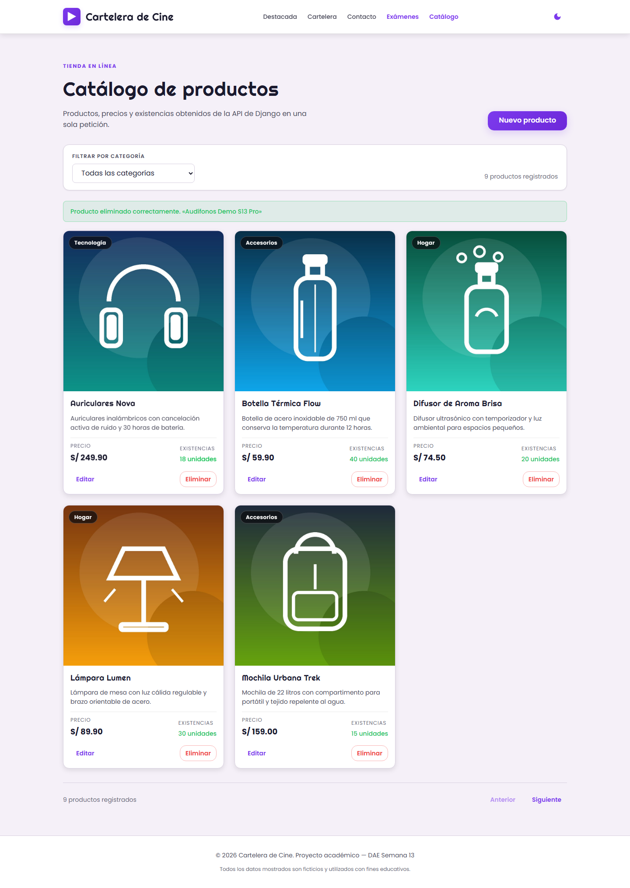

**Código relevante** (`frontend/src/pages/CatalogPage/CatalogPage.jsx`):

```jsx
const handleDelete = async (product) => {
  const confirmed = window.confirm(
    `${UI_TEXT.CATALOG_DELETE_CONFIRM} «${product.name}»?`,
  )
  if (!confirmed) return

  setDeletingId(product.id)
  setActionError(null)

  try {
    await remove(product.id)
    const wasLastOnPage = products.length === 1
    removeLocal(product.id)
    setFlash(`${UI_TEXT.CATALOG_DELETED} «${product.name}»`)

    if (wasLastOnPage && pagination.previous) {
      goToPreviousPage()
    } else {
      reload()
    }
  } catch (requestError) {
    setActionError(normalizeApiError(requestError))
  } finally {
    setDeletingId(null)
  }
}
```

**Explicación del resultado:** el diálogo de confirmación evita borrados accidentales. Tras el `DELETE 204`, la tarjeta desaparece de inmediato del estado local, se muestra `Producto eliminado correctamente` y el contador vuelve a 9. Después se refresca la página actual; si se borró el último elemento de una página, se retrocede a la anterior.

**Casos de prueba:**

- Cancelar la confirmación: no se envía ninguna petición.
- Aceptar: `204`, la tarjeta desaparece y el contador baja.
- Borrar el único producto de la página 2: se vuelve a la página 1.
- Detener Django y borrar: se muestra el error de la acción sin quitar la tarjeta.

### Captura 14 — Estructura del proyecto en VS Code

**Título del desarrollo:** Servidor y cliente conviviendo en el mismo repositorio.

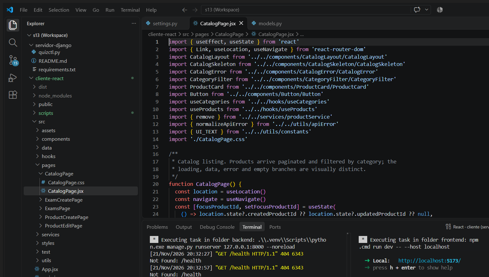

**Código relevante** (árbol del repositorio):

```text
DAE_Semana_13/
├── backend/
│   ├── catalog/
│   │   ├── management/commands/seed_catalog.py
│   │   ├── migrations/
│   │   ├── seed_images/
│   │   ├── tests/test_api.py
│   │   ├── admin.py
│   │   ├── models.py
│   │   ├── serializers.py
│   │   ├── urls.py
│   │   └── views.py
│   ├── config/
│   ├── media/
│   └── quiz/
├── frontend/
│   ├── src/
│   │   ├── components/
│   │   ├── hooks/
│   │   ├── pages/
│   │   ├── services/
│   │   └── utils/
│   └── package.json
├── entregable/
└── README.md
```

**Explicación del resultado:** el workspace de VS Code muestra las dos raíces (`servidor-django` y `cliente-react`) y dos terminales integradas: Django en `127.0.0.1:8000` y Vite en `localhost:5173`. El editor abierto es `CatalogPage.jsx`, que importa la capa de servicios; no hay ningún `import axios` fuera de `src/services/`. La estructura deja claro el reparto: el servidor y el cliente se ejecutan por separado y se comunican por HTTP.

**Casos de prueba:**

- Comprobar que ambos terminales están activos y sin errores de arranque.
- Abrir `backend/catalog/models.py` y `frontend/src/pages/CatalogPage/CatalogPage.jsx` en el mismo workspace.
- Verificar que `backend/` y `frontend/` están en el mismo repositorio.
- Buscar `axios` en `frontend/src`: solo aparece en `services/apiClient.js`.

## 6. Verificación final

| Comprobación | Resultado |
|---|---|
| Migraciones aplicadas y catálogo sembrado | 3 categorías y 9 productos |
| Pruebas del backend | 380 pruebas aprobadas (8 del catálogo + las de la semana 12) |
| Pruebas del frontend | 71 pruebas aprobadas |
| Lint del frontend | Sin errores (`oxlint`) |
| Build de producción | Correcto (`vite build`) |
| `axios` fuera de `src/services/` | Sin coincidencias |
| CORS | Solo `http://localhost:5173`, sin `*` |
| Categoría anidada en una petición | Verificado en `/api/products/` |
| Crear, editar y eliminar sin recarga | Verificado en las capturas 10, 12 y 13 |
| Semana 12 | La app `quiz`, su API y sus pruebas se conservan |

Comandos usados para verificar:

```powershell
cd backend
.\.venv\Scripts\python.exe manage.py test
.\.venv\Scripts\python.exe manage.py check

cd ..\frontend
npm run test
npm run lint
npm run build
```

## 7. Conclusiones

1. **La separación en servicios mantiene el cliente desacoplado de la API.** Al concentrar Axios en `src/services/`, los componentes y hooks solo conocen funciones como `list`, `getById`, `create`, `update` y `remove`. Eso permite cambiar la URL base, añadir un interceptor o migrar de biblioteca sin tocar las pantallas, y se comprueba con una búsqueda: `axios` solo aparece en `apiClient.js`.

2. **La categoría anidada y `select_related` resuelven el problema en una sola petición.** El catálogo necesita el nombre de la categoría en cada tarjeta; devolverlo dentro del producto evita una segunda llamada por fila y `select_related` evita el N+1 en la base de datos. La paginación se maneja siguiendo los enlaces `next` y `previous` que entrega DRF, de modo que el filtro y los cambios de página siguen siendo coherentes.

3. **Los estados explícitos y la validación del servidor producen una interfaz predecible.** El esqueleto de carga, el error con reintento, el estado vacío y los mensajes por campo del `400` cubren los caminos reales de una petición. Además, crear, editar y eliminar actualizan el catálogo sin recargar la página, y el admin y el comando `seed_catalog` hacen que la demostración sea reproducible en cualquier equipo.
